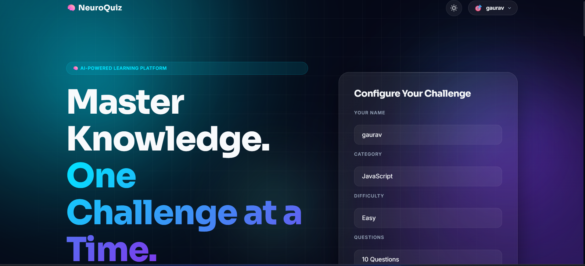
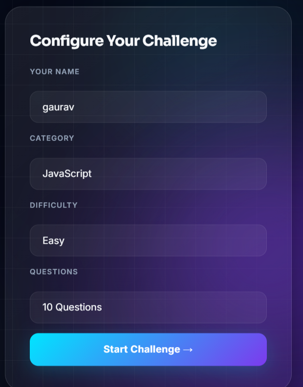
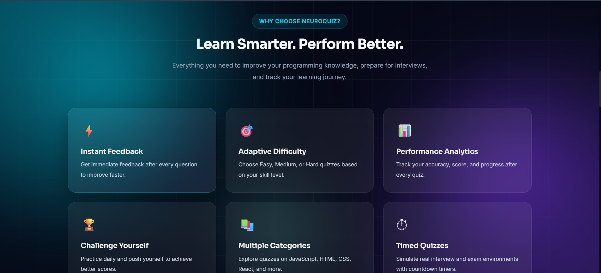
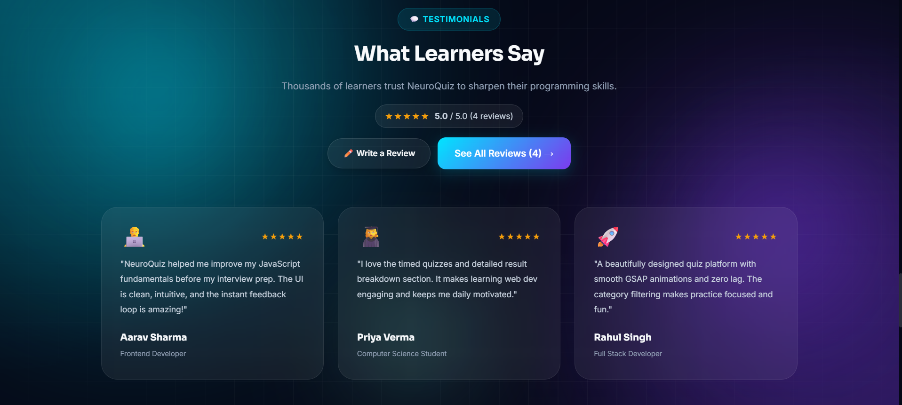
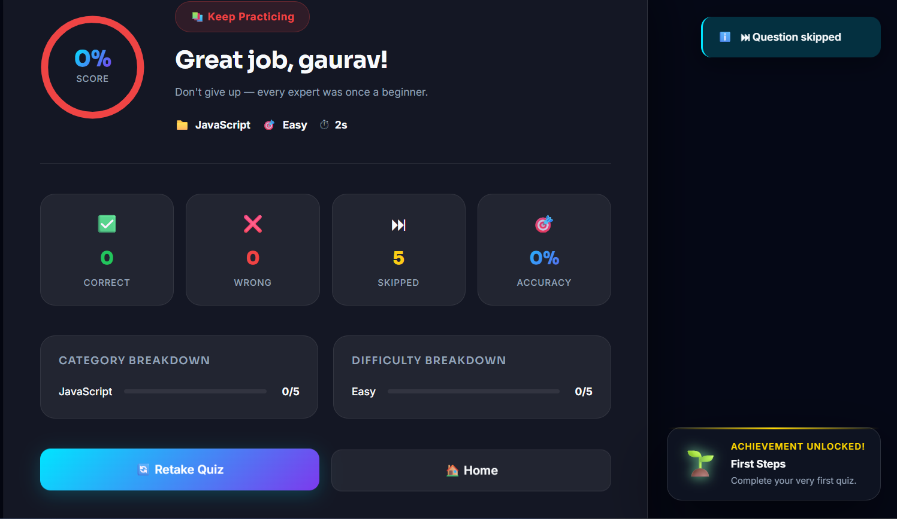
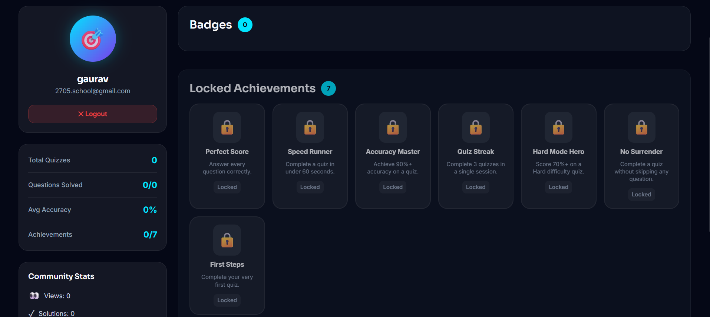

<div align="center">

# 🧠 NeuroQuiz

### Master Knowledge. One Challenge at a Time.

A modern AI-inspired quiz platform built with **Vanilla JavaScript, Vite, and GSAP**, featuring a premium UI, responsive design, gamification, achievement system, review mode, and interactive learning experience.

🌐 **Live Demo:** https://neuroquiz-g.vercel.app




</div>

---

# 📑 Table of Contents

- [Overview](#-overview)
- [Features](#-features)
- [Key Highlights](#-key-highlights)
- [Tech Stack](#-tech-stack)
- [Project Structure](#-project-structure)
- [Getting Started](#-getting-started)
- [Screenshots](#-screenshots)
- [Learning Outcomes](#-learning-outcomes)
- [Lighthouse Report](#-lighthouse-report)
- [Future Improvements](#-future-improvements)
- [Developer](#-developer)
- [Support](#-show-your-support)

---

# 📖 Overview

NeuroQuiz is a modern frontend quiz application designed to deliver an engaging and interactive learning experience.

The project showcases modern frontend development concepts including:

- Beautiful Glassmorphism UI
- Responsive Design
- GSAP Animations
- Modular JavaScript Architecture
- Local Storage
- Achievement System
- Interactive Dashboard
- Quiz Review Mode
- Performance Optimization
- Accessibility Best Practices

Built as a portfolio project, NeuroQuiz demonstrates production-ready frontend development using Vanilla JavaScript.

---

# ✨ Features

## 🎯 Quiz Experience

- Multiple Categories
- Multiple Difficulty Levels
- Configurable Number of Questions
- Real-Time Countdown Timer
- Previous & Next Navigation
- Question Palette
- Live Progress Tracking
- Instant Answer Selection
- Auto Submit
- Manual Submission

---

## 📊 Result Dashboard

- Final Score
- Accuracy Percentage
- Correct Answers
- Wrong Answers
- Performance Summary
- Animated Result Cards

---

## 📚 Review Mode

- Review Every Question
- Correct Answer Highlight
- Selected Answer Highlight
- Detailed Explanations
- Navigation Between Questions

---

## 🏆 Achievement System

Unlock badges like:

- 🎯 Perfect Score
- ⚡ Speed Runner
- 🏅 Accuracy Master
- 🔥 Quiz Streak
- 💪 Hard Mode Hero
- 🚫 No Surrender
- 🌱 First Steps

---

## 👤 Dashboard

- User Statistics
- Achievement Progress
- Recent Quizzes
- Community Stats
- Badge Collection

---

# 🚀 Key Highlights

- 🎨 Modern Glassmorphism UI
- 📱 Fully Responsive Design
- ⚡ High Performance
- ♿ Accessibility Friendly
- 🎯 Interactive Quiz Experience
- 🏆 Gamification with Achievements
- 📊 Analytics Dashboard
- 🔥 GSAP Animations
- 🌐 Deployed on Vercel

---

# ⚡ Performance

| Category | Score |
|----------|------:|
| 🚀 Performance | **91** |
| ♿ Accessibility | **100** |
| ✅ Best Practices | **96** |
| 🔍 SEO | **100** |

---

# 🛠 Tech Stack

| Category | Technology |
|----------|------------|
| Frontend | HTML5, CSS3, JavaScript (ES6) |
| Build Tool | Vite |
| Animation | GSAP |
| Icons | Font Awesome |
| Storage | Local Storage |
| Version Control | Git & GitHub |
| Deployment | Vercel |

---

# 📂 Project Structure

```text
src/
│
├── components/
├── pages/
├── handlers/
├── utils/
├── styles/
├── data/
├── js/
└── main.js
```

---

# 🚀 Getting Started

### Clone Repository

```bash
git clone https://github.com/Gaurav18071/NeuroQuiz.git
```

### Open Project

```bash
cd NeuroQuiz
```

### Install Dependencies

```bash
npm install
```

### Run Development Server

```bash
npm run dev
```

### Production Build

```bash
npm run build
```

### Preview Production Build

```bash
npm run preview
```

---

# 📱 Screenshots

## 🏠 Landing Page


---

## 🎯 Quiz Interface



---

## 🌟 Why Choose NeuroQuiz



---

## 💬 Testimonials



---

## 📊 Dashboard



---

## 🏆 Achievements



---

# 🧠 Learning Outcomes

Through this project I improved my understanding of:

- Component-Based Architecture
- Modular JavaScript
- ES6 Modules
- DOM Manipulation
- State Management
- Responsive Web Design
- GSAP Animations
- Local Storage
- Accessibility
- Performance Optimization
- Git & GitHub Workflow
- Deployment with Vercel

---

# 🌟 Future Improvements

- User Authentication
- Backend Integration
- Database Support
- AI Question Generation
- Multiplayer Quiz
- Global Leaderboard
- Admin Dashboard
- Analytics Dashboard
- Social Login
- User Profiles

---

# 👨‍💻 Developer

## Gaurav Mishra

**B.Tech Computer Science & Engineering**

### Connect With Me

- 💼 LinkedIn: https://linkedin.com/in/gaurav18071
- 💻 GitHub: https://github.com/Gaurav18071
- 🌐 Portfolio: https://gaurav-portfolio-ea7.pages.dev

---

# ⭐ Show Your Support

If you found this project useful, please consider giving it a ⭐ on GitHub.

Your support motivates me to build more amazing projects.

---

<div align="center">

### Thank you for visiting! 🚀

Made with ❤️ by **Gaurav Mishra**

</div>